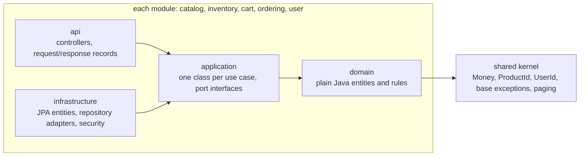
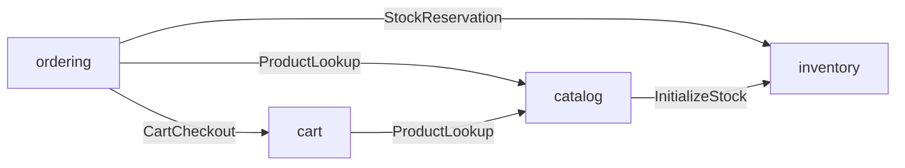

# Small Shop API

Backend for a small-business online shop. The shop owner manages the catalog, stock and orders. Customers browse products, keep a cart, place orders, see their order history and cancel orders that have not shipped yet.

Java 21, Spring Boot 3.5, PostgreSQL, Spring Data JPA, Flyway, Spring Security with JWT, Testcontainers, ArchUnit, GitHub Actions, OpenAPI.

## Running it

Requirements: JDK 21 and Docker.

```bash
docker compose up -d --wait                                 
./mvnw spring-boot:run -Dspring-boot.run.profiles=local      
```

The `local` profile supplies a development JWT secret and creates an admin account on first start:
`admin@smallshop.local` / `admin-password`. Never use that profile outside your own machine.

Open http://localhost:8080/swagger-ui.html, call `POST /api/auth/login`, then paste the `accessToken` into **Authorize**.

Outside the `local` profile the app refuses to start without a JWT secret. Configuration comes from environment variables:

| Variable | Required | Default |
|---|---|---|
| `JWT_SECRET` | yes, at least 32 bytes | none |
| `JWT_TIME_TO_LIVE` | no | `1h` |
| `DB_URL` / `DB_USERNAME` / `DB_PASSWORD` | no | the Compose database |
| `ADMIN_EMAIL` / `ADMIN_PASSWORD` | no | no admin is created |

Run the tests (Docker must be running, Testcontainers starts its own PostgreSQL):

```bash
./mvnw verify
```

## API overview

| Who | Endpoints |
|---|---|
| Anyone | `POST /api/auth/register`, `POST /api/auth/login`, `GET /api/products?page&size&categoryId&search`, `GET /api/products/{id}`, `GET /api/categories` |
| Customer | `GET /api/cart`, `POST /api/cart/items`, `PUT/DELETE /api/cart/items/{productId}`, `POST /api/orders` (from cart), `GET /api/orders`, `GET /api/orders/{id}`, `POST /api/orders/{id}/cancel` |
| Admin | `/api/admin/categories`, `/api/admin/products` (create, update, list including inactive, `DELETE` = deactivate, `POST /{id}/activate`), `GET/PUT /api/admin/products/{id}/stock`, `GET /api/admin/orders?status`, `POST /api/admin/orders/{id}/pay`, `/ship`, `/deliver`, `/cancel` |

Errors use RFC 9457 problem details: 400 validation (with an `errors` map per field), 401 not logged in or bad credentials, 403 wrong role, 404 not found, 409 business rule broken (insufficient stock, invalid status transition, duplicate email or category name, empty cart).

## Architecture

Hexagonal (ports and adapters), organised by feature module. Each module has the same four layers:



How the modules call each other (always through the other module's application layer):



The rules are enforced by [ArchitectureTest](src/test/java/com/smallshop/ArchitectureTest.java), which fails the build if:

- a `domain` class depends on Spring, JPA, Hibernate or Jackson, or on any outer layer
- an `application` class depends on `infrastructure` or `api`
- a module touches another module's `domain`, `infrastructure` or `api`
- the shared kernel depends on a module

## Key design decisions

**One Maven module, boundaries checked by ArchUnit.** Splitting into Maven modules would let the compiler enforce boundaries, but it costs a parent POM, inter-module wiring and slower builds. At this size the ArchUnit tests give the same protection in CI. Separate Maven modules make sense once different teams own modules or modules are released separately.

**Plain-Java domain with separate JPA entities.** Business rules (order state machine, stock never below zero, price freezing) are unit tested in milliseconds without Spring. The cost is a mapping step in each repository adapter.

**Inventory owns stock, in its own table.** Product details rarely change, but stock changes on every order. Keeping stock in `stock_items` means a checkout lock never blocks an admin editing a product description, and the other way round.

**No overselling: pessimistic locking in a fixed order.** Reserving stock runs `SELECT ... FOR UPDATE ... ORDER BY product_id`, then the domain `StockItem.reserve` checks the quantity. Every transaction locks rows in the same order, so two orders containing the same products cannot deadlock.
[StockReservationConcurrencyTest](src/test/java/com/smallshop/StockReservationConcurrencyTest.java) sends 20 buyers at 5 units at the same instant: exactly 5 orders succeed and stock ends at 0. A second test sends carts containing the same two products in opposite order, and no transaction deadlocks. With the lock removed, the first test fails: all 20 orders succeed, because concurrent updates overwrite each other.
Rejected alternatives:
- Optimistic locking (`@Version`): good when conflicts are rare, but "last units of a popular product" is exactly when they are not, so it means many retries.
- Atomic `UPDATE ... SET available = available - ? WHERE available >= ?`: faster, but moves the business rule into SQL. It is the next step if lock waits ever show up as a measured bottleneck.

**Order status changes lock the order row.** Cancelling releases stock. Without a lock, an admin and a customer cancelling at the same moment could both release the same units.

**Price frozen on the order line.** `OrderLine` copies the product name and unit price when the order is placed. The cart, by contrast, always shows current catalog prices.

**Soft delete.** `DELETE /api/admin/products/{id}` deactivates the product. It disappears from browsing and carts can no longer order it, while old orders still render because their lines carry their own copy of name and price. Foreign keys from `order_lines` to `products` stay valid because rows are never removed.

**IDs are UUIDs created in the domain.** An object is complete before it is saved, modules refer to each other by typed IDs (`ProductId`, `UserId`), and IDs in URLs cannot be guessed. `ProductId` and `UserId` live in the shared kernel because several modules reference them.

**Money is a `BigDecimal` record.** It is never negative, has exactly two decimals (more are rejected rather than silently rounded), and is stored as `NUMERIC(12,2)`.

**JWT with Spring's resource server.** Tokens are signed HS256 with a secret from the environment, and carry the user id as `sub` and the role as a claim. Spring's built-in `BearerTokenAuthenticationFilter` validates them, so there is no hand-written filter. CSRF protection is off because the API is stateless and uses no cookies. Passwords are hashed with BCrypt. Login returns the same error for an unknown email and a wrong password.

**One transaction to place an order.** The order is created, stock is reserved and the cart is cleared in one database transaction. A failed reservation leaves no order and an untouched cart. A single database makes this possible without distributed transactions or sagas.

## Trade-offs and known limitations

- **Name search** uses `lower(name) LIKE '%term%'`, which scans the table. A `pg_trgm` GIN index would fix it for a large catalog.
- **One shared signing secret (HS256)** is fine for one service. Several services verifying tokens would call for asymmetric keys (RS256) or a dedicated auth server. There are no refresh tokens or token revocation.
- **Login timing:** an unknown email returns slightly faster than a wrong password, because no hash is checked.
- **Carts are not locked:** two simultaneous requests from the same customer can overwrite each other. That's harmless for a cart, and stock is only taken when ordering.
- **Payment is simulated** by an admin "mark as paid" action. Cancelling a paid order releases stock but does not model a refund.
- **A few application classes group two closely related operations** instead of strictly one use case per class, for example activate/deactivate in `ChangeProductAvailability` and get/set in `ManageStockLevel`.

## Tests

| Kind | Where | What it covers |
|---|---|---|
| Domain unit tests | `*/domain/*Test` | Money, order state machine (`cancellingAShippedOrderFails`), stock reservation, cart rules, price freezing |
| Use case tests | `*/application/*Test` | Mocked ports: place order, cancel and release stock, registration, login |
| Persistence | `*RepositoryAdapterTest` | Testcontainers PostgreSQL with the real Flyway schema: search, paging, order history |
| Controllers | `*/api/*ControllerTest` | MockMvc: status codes, validation, role-based access |
| End to end | `ShopFlowIntegrationTest` | Real HTTP flow with real JWTs: buy, frozen price after a price change, cancel restores stock, soft delete |
| Concurrency | `StockReservationConcurrencyTest` | No overselling and no deadlocks under parallel checkouts |
| Architecture | `ArchitectureTest` | Layer and module boundaries |

CI runs `./mvnw verify` on every push and pull request ([ci.yml](.github/workflows/ci.yml)).
